# Dusk Princess and Twilight Prince

**듣지 못하는 공주와 보지 못하는 왕자가 서로의 감각이 되어 황혼의 숲을 오르는 2D 플랫포머 퍼즐 게임입니다.**

| 플레이 인원 | 플레이 시간 | 조작 장치 | 언어 |
| --- | --- | --- | --- |
| 1인 (두 주인공을 번갈아 조작) | 약 15분 | 키보드, 게임패드, 마이크(선택) | 한국어 |

## 게임 소개

전쟁으로 청력을 잃고 버림받은 공주와 암습으로 시력을 잃은 왕자가 저주받은 숲에서 만납니다. 두 사람은 눈과 귀를 고쳐 줄 샘물이 있는 곳을 안다는 황혼의 마녀를 찾아 함께 숲을 오릅니다. 끝에서 만난 마녀는 그런 형편 좋은 샘물은 없다고 말하지만, 이미 서로의 눈과 귀가 된 두 사람은 손을 잡고 숲 너머로 걸어가고, 마녀는 그 뒷모습을 보며 웃습니다.

플레이어는 버튼 하나로 두 사람을 전환합니다. 전환은 단순히 캐릭터만 바꾸지 않고, **같은 장소를 느끼는 방식 자체를 바꿉니다.**

<table>
  <tr>
    <th width="50%">공주: 볼 수 있지만 들을 수 없습니다</th>
    <th width="50%">왕자: 들을 수 있지만 볼 수 없습니다</th>
  </tr>
  <tr>
    <td></td>
    <td>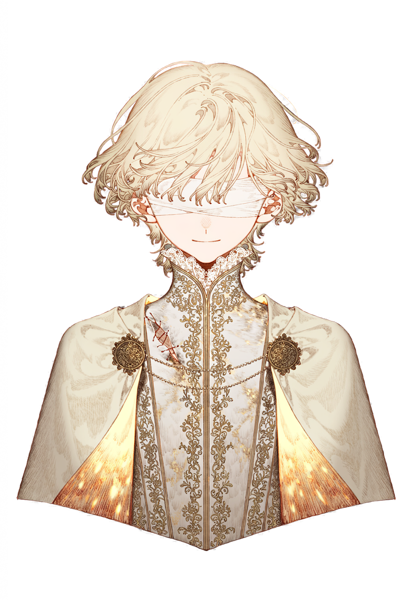</td>
  </tr>
  <tr>
    <td>세계가 밝게 보이지만 효과음이 사라지고 음악은 먹먹해집니다. 주요 소리는 의성어 자막으로 대신 전달됩니다. 공주는 무거운 상자를 밀고 당기며, 압력판을 눌러 철문을 엽니다.</td>
    <td>세계가 어둠에 잠기고, 메아리가 닿은 곳만 잠시 드러납니다. 왕자는 메아리로 숨은 발판과 가짜 벽을 찾아내고, 금빛 물체에 말을 걸어 길이를 바꾸거나 떠 있는 돌을 떨어뜨립니다.</td>
  </tr>
</table>

## 주요 기능

### 감각 전환

Tab 또는 Q를 누르면 조작하는 인물이 바뀌고, 주인공을 중심으로 파동이 번지면서 세계의 모습과 소리가 함께 달라집니다. 두 감각에서 얻는 정보가 서로 다르기 때문에, 플레이어는 길이 막힐 때마다 감각을 바꿔 가며 답을 찾습니다.

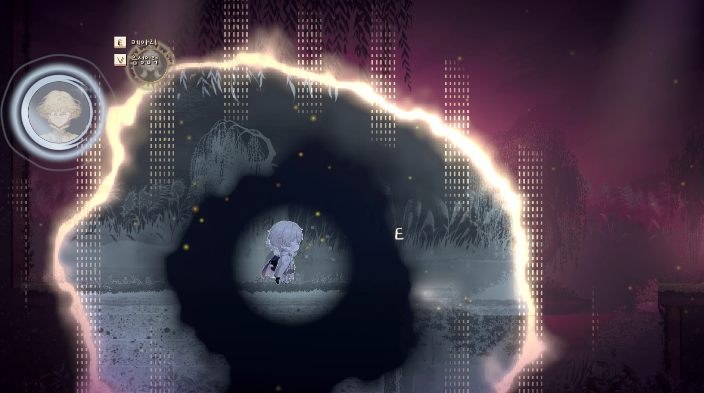

### 메아리와 숨은 발판

왕자의 세계는 어둠에 잠겨 있으며, E를 눌러 보낸 메아리가 닿은 곳만 잠시 드러납니다. E를 오래 누를수록 메아리가 더 멀리 퍼지고, 메아리를 모으는 동안에는 왕자 옆에 금빛 고리가 나타납니다.

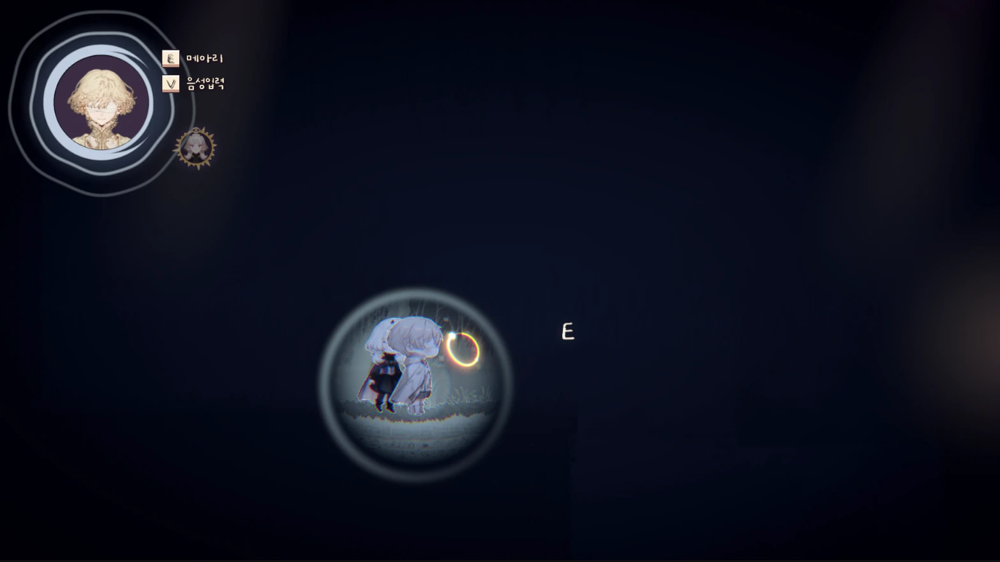

공주의 화면에서는 건널 길이 없어 보이는 구덩이도, 왕자가 메아리를 보내면 허공에 놓인 발판이 드러납니다.

<table>
  <tr>
    <th width="50%">공주의 화면: 구덩이 위에 아무것도 보이지 않습니다</th>
    <th width="50%">왕자의 화면: 메아리가 숨은 발판을 드러냅니다</th>
  </tr>
  <tr>
    <td>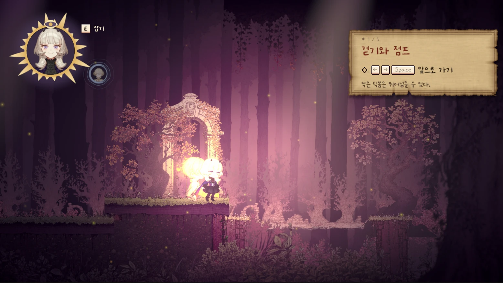</td>
    <td>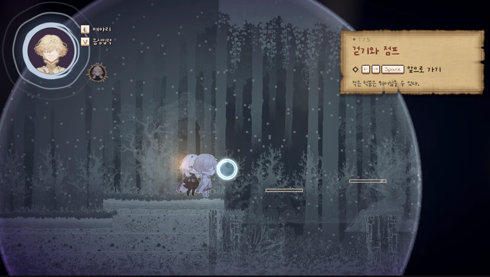</td>
  </tr>
</table>

### 가짜 벽

가짜 벽은 공주에게 진짜 벽과 다르지 않아서, 공주가 벽을 밀면 머리 위에 물음표만 떠오릅니다. 왕자의 메아리가 닿으면 벽의 정체가 붉게 드러나고, 그 뒤로는 두 사람 모두 지나갈 수 있습니다.

<table>
  <tr>
    <th width="50%">공주의 화면: 막다른 벽으로 보입니다</th>
    <th width="50%">왕자의 화면: 메아리가 가짜 벽을 찾아냅니다</th>
  </tr>
  <tr>
    <td>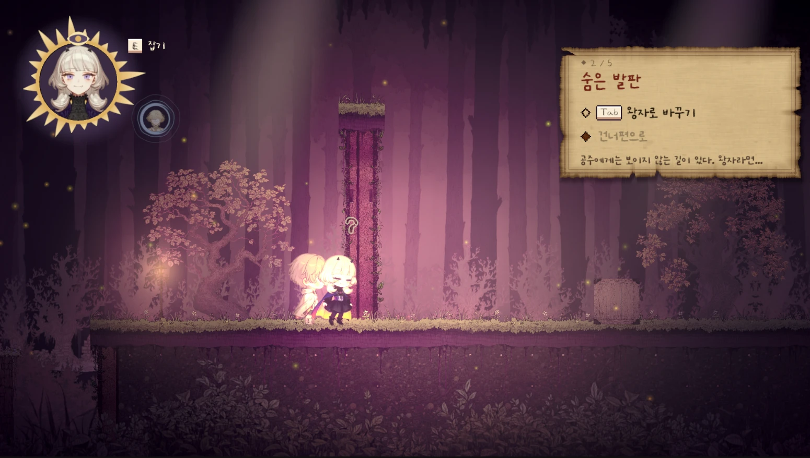</td>
    <td>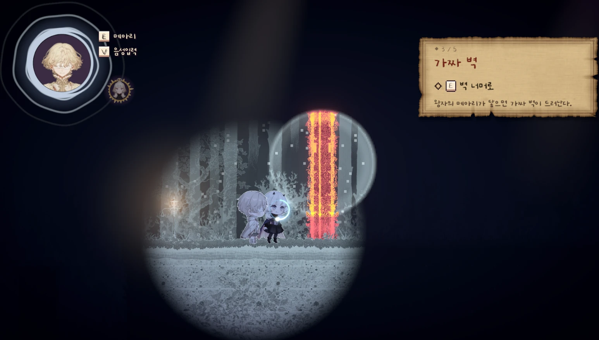</td>
  </tr>
</table>

### 공주의 힘: 상자와 압력판

무거운 상자는 공주만 움직일 수 있습니다. 공주는 상자를 밀어서 높은 곳으로 올라가는 발판을 만들고, E를 누른 채 상자를 당겨서 위치를 바로잡으며, 상자를 압력판 위에 올려서 철문을 엽니다.

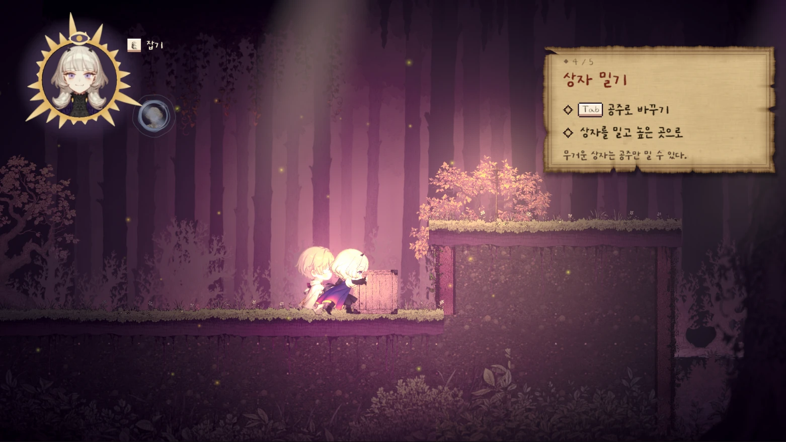

### 말 퍼즐: 왕자의 말이 세계를 바꿉니다

왕자는 금빛 물체와 떠 있는 돌에 말을 걸 수 있습니다. V를 누른 채 자신의 말투로 말해도 되고, E를 짧게 눌러 여는 말 선택 창에서 골라도 같은 퍼즐을 풀 수 있습니다.

- **다리와 통나무**는 "길어져"라는 말에 늘어나고 "짧아져"라는 말에 줄어듭니다.
- **기둥**은 "짧아져"라는 말에 낮아져서 앞을 막던 길을 열어 줍니다.
- **떠 있는 돌**은 "무거워져"라는 말에 떨어지며, 떨어진 돌로 압력판을 누를 수도 있습니다.

말이 일으킨 소리는 공주의 화면에서 의성어 자막으로 표시됩니다. 아래 오른쪽 사진에서는 다리가 늘어나는 소리가 "쭈욱"이라는 자막으로 나타납니다.

<table>
  <tr>
    <th width="50%">말 선택 창: 마이크 없이도 풀 수 있습니다</th>
    <th width="50%">결과: 다리가 늘어나 건너편과 이어집니다</th>
  </tr>
  <tr>
    <td>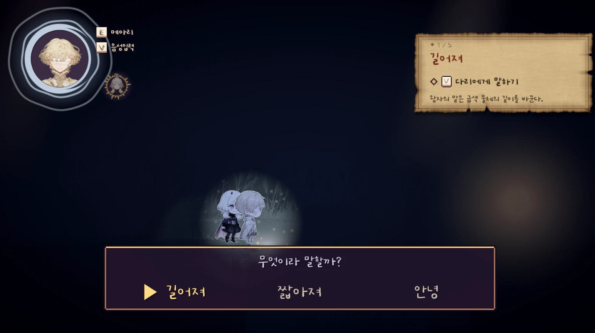</td>
    <td>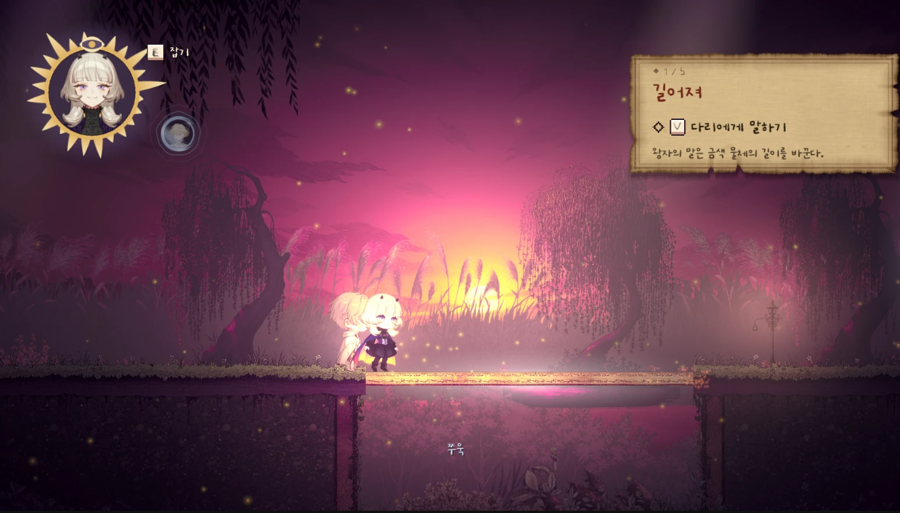</td>
  </tr>
</table>

### 그림책으로 전하는 이야기

프롤로그와 단계 사이의 막간, 엔딩은 모두 그림책으로 진행되며, 이야기는 문구로 전달되므로 소리 없이도 이해할 수 있습니다. 엔딩에서는 세피아 톤이던 그림에 장을 넘길수록 색이 살아납니다.

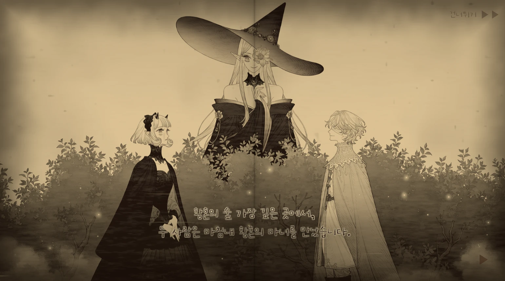

### 단계 구성

| 단계 | 이름 | 핵심 기믹 |
| --- | --- | --- |
| 1 | 서로 다른 두 사람 | 숨은 발판, 가짜 벽, 상자 밀기 |
| 2 | 네 말이 빛이 될 때 | 늘어나는 다리, 짧아지는 기둥, 떨어지는 돌 |
| 3 | 작은 손이 여는 길 | 상자 당기기, 압력판과 철문, 금빛 통나무 |
| 4 | 보이지 않는 문을 두드리며 | 3층 구조의 동굴, 공주만 읽을 수 있는 해·달·별 그림 |
| 5 | 우리가 함께 오르는 황혼 | 앞선 기믹을 엮은 퍼즐 4개, 어두운 숲에서 황혼까지 오르는 탑 |

## 해커톤 주제와의 연결

「게임 안에, 모두를 담다」의 네 가지 세부 주제 가운데 다음 세 가지를 게임의 설계에 반영했습니다.

### 1. 고정관념과 장벽 깨기: 캐릭터도, 플레이도, 누구나 자유롭게

이 게임에서 힘을 쓰는 사람은 공주입니다. 공주는 왕자보다 힘이 세서 무거운 짐을 도맡고, 왕자는 섬세한 감각으로 숨은 길을 찾습니다. 구해지는 공주와 구하는 왕자라는 익숙한 구도를 뒤집은 것입니다.

두 주인공의 장애는 고쳐야 할 결핍으로 그려지지 않습니다. 두 사람은 서로의 부족한 감각을 메우며 신체적 제약을 함께 넘어서고, 이야기도 치료가 아니라 함께 나아가는 모습으로 끝납니다. 왕자의 메아리는 실제 시각장애인이 쓰는 반향정위(echolocation)에서 가져왔고, 공주의 세계는 완전한 무음 대신 먹먹한 음악이 남도록 해 청각장애를 '아무것도 듣지 못하는 상태'로 단순화하지 않았습니다.

### 2. 플레이의 문 넓히기: 더 많은 사람이 함께 즐길 수 있게

왕자의 말 퍼즐은 **AI 음성 입력과 대체 입력을 모두 지원**하므로, 플레이어는 자신에게 편한 방식으로 같은 퍼즐을 풀 수 있습니다.

| 입력 방식 | 플레이 방법 |
| --- | --- |
| 음성 입력 | V를 누른 채 말합니다. 정해진 정답 문장이 없으므로 "길어져", "쭉 늘어나라"처럼 자신의 말투로 말해도 AI가 뜻을 판단합니다. |
| 대체 입력 | E를 짧게 눌러 말 선택 창을 열고, 키보드나 게임패드로 "길어져", "짧아져", "무거워져" 같은 말을 고릅니다. 마이크나 발화가 필요하지 않습니다. |

이 밖에도 플레이의 문턱을 낮추는 요소를 넣었습니다.

- 장치가 내는 주요 소리를 의성어 자막으로도 보여 줍니다. 프롤로그와 엔딩 등 이야기는 그림책 문구로 전달되어 소리 없이도 이해할 수 있습니다.
- 음성으로 감각을 전환하거나 점프할 수 있고, 왕자의 메아리를 목소리 크기로 보낼 수도 있습니다.
- 떨어져도 가까운 체크포인트에서 바로 다시 시작하고, 퍼즐이 꼬이면 체크포인트 상태로 되돌릴 수 있습니다.
- 전체, 음악, 효과음의 볼륨을 각각 조절하고 사용할 마이크를 선택할 수 있습니다.
- 설정의 **접근성** 항목에서 자막·안내 글자 크기(100~160%), 화면 흔들림 끄기, 색약 모드(적색약·녹색약·청황색약 보정), 읽기 쉬운 글꼴을 고를 수 있습니다.
- 공주에게만 보이는 정답 표식은 색이 아니라 모양(해·달·별)으로 구분해, 색을 구분하지 못해도 풀 수 있습니다.

### 3. 다른 시선 플레이하기: 차이와 편견을 새로운 룰과 이야기로

**눈이 불편한 사람과 귀가 불편한 사람의 차이를 게임의 핵심 규칙으로 만들었습니다.** 각 감각으로만 알 수 있는 것과 각 인물만 할 수 있는 일이 다르기 때문에, 플레이어는 두 사람을 오가야만 앞으로 나아갑니다.

- 공주에게 막다른 벽으로 보이는 곳이 왕자의 메아리로 확인하면 지나갈 수 있는 가짜 벽이기도 합니다. 공주가 막혀 머리 위에 물음표를 띄울 때, 왕자로 전환하면 길이 보입니다.
- 공주의 눈에 보이지 않는 숨은 발판을 왕자는 메아리로 찾아냅니다. 반대로 4단계에서는 왕자에게 보이지 않는 해, 달, 별 그림을 공주만 읽을 수 있습니다.
- 왕자는 말로 다리를 늘일 수 있지만 상자를 밀지 못하고, 공주는 상자를 밀 수 있지만 다리를 늘이지 못합니다.

플레이어는 소리가 사라진 세계와 어둠에 잠긴 세계를 직접 오가면서, 한쪽에서 막힌 문제의 답을 다른 쪽에서 찾습니다. 그 과정에서 두 감각이 우열의 대상이 아니라 서로를 보완하는 능력임을 플레이로 경험합니다.

## 실행 방법

1. 제출한 압축 파일을 영문 경로(예: `C:\Games\DuskTwilight`)에 풀고 `DuskTwilight.exe`를 실행합니다. AI 모델이 빌드에 포함되어 있으므로 별도의 설치나 네트워크 연결이 필요하지 않습니다.
2. 타이틀 화면에서 게임을 시작합니다. **단계 선택**으로 원하는 단계부터 바로 시작할 수도 있습니다.
3. 음성 입력을 사용하려면 마이크를 연결하고 설정 화면에서 사용할 마이크를 선택합니다. 마이크가 없어도 말 선택 창으로 끝까지 플레이할 수 있습니다.

실행 환경은 Windows PC이며, 음성 인식과 말 판정을 빠르게 처리하려면 GPU가 있는 환경을 권장합니다.

## 조작 방법

| 동작 | 키보드 | 게임패드 |
| --- | --- | --- |
| 이동 | A / D, ← / → | 왼쪽 스틱, D-pad |
| 점프 | Space, W, ↑ | A |
| 감각 전환 | Tab, Q | Y |
| 상자 밀기 (공주) | 상자 쪽으로 이동 | 왼쪽 스틱, D-pad |
| 상자 당기기 (공주) | E를 누른 채 반대쪽으로 이동 | B를 누른 채 반대쪽으로 이동 |
| 메아리 (왕자) | E | X |
| 음성 입력 (왕자) | V를 누른 채 말하기 | LB를 누른 채 말하기 |
| 말 선택 창 열기 (왕자) | 금빛 물체나 떠 있는 돌 근처에서 E를 짧게 누르기 | 금빛 물체나 떠 있는 돌 근처에서 B |
| 말 선택 창에서 고르기 | ← / → 후 E, 또는 숫자 키 | 왼쪽 스틱 후 A 또는 B |
| 체크포인트로 되돌리기 | Backspace | Select |
| 일시정지·설정 | Esc | Start |

왕자는 E를 누르고 있다가 떼면 메아리를 보냅니다. 오래 누를수록 메아리가 더 멀리 퍼집니다. 금빛 물체나 떠 있는 돌 근처에서 E를 짧게 누르면 메아리 대신 말 선택 창이 열립니다.

## AI 활용 내용

### 게임 내 플레이 지원 기능

왕자가 말로 세계를 바꾸는 퍼즐에 두 가지 AI를 사용했습니다. 플레이어가 정답 단어를 외우지 않아도, 자신의 말투로 말하면 게임이 그 뜻을 이해합니다.

| AI | 역할 | 활용 내용 |
| --- | --- | --- |
| Whisper | STT 엔진 | 플레이어의 음성을 글자로 변환합니다. 현재 장면에서 쓰이는 명령어를 힌트로 제공해 인식률을 높였습니다. |
| Kanana | 결정 엔진 | 변환된 말의 뜻을 판단해 금빛 물체와 떠 있는 돌에 적용할 결과를 결정합니다. |

음성 입력은 다음 순서로 처리됩니다.

1. 플레이어가 V를 누른 채 금빛 물체에 말을 겁니다.
2. Whisper가 음성을 글자로 변환하고, 자모 하나 정도 다르게 인식된 말은 게임이 보정합니다.
3. 자주 쓰이는 표현은 게임이 바로 판정하고, 판단하기 어려운 표현만 Kanana에 전달합니다.
4. Kanana는 자유로운 문장을 생성하지 않고, 미리 정해진 선택지 가운데 말의 뜻에 맞는 결과를 고릅니다. 확신이 낮으면 아무것도 실행하지 않습니다.
5. 게임이 결과에 따라 다리와 기둥의 길이를 바꾸거나 떠 있는 돌을 떨어뜨립니다.

이렇게 설계한 이유는 두 가지입니다. 먼저 AI의 출력을 정해진 선택지로 제한하면, 말투의 자유를 보장하면서도 AI가 엉뚱한 답을 내어 게임 진행을 망가뜨리는 일을 막을 수 있습니다. 또한 두 AI 모두 플레이어의 PC에서 로컬로 실행되므로 네트워크와 API 키가 필요하지 않고, 플레이어의 음성도 외부로 전송되지 않습니다.

### 개발에 사용한 AI

| 도구 | 분류 | 활용 내용 |
| --- | --- | --- |
| Autosprite | 애니메이션 생성 AI | 정적 이미지에서 애니메이션 스프라이트를 생성했습니다. |
| Suno | 음악 생성 AI | 게임에 사용하는 음악을 생성했습니다. |
| NovelAI | 이미지 생성 AI | 게임에 사용하는 이미지를 생성했습니다. |
| ElevenLabs | 음성 생성 AI | 캐릭터 보이스를 생성했습니다. |
| Claude Code, Antigravity, Codex | AI 코딩 에이전트 | 게임 개발에 코딩 에이전트로 활용했습니다. |
