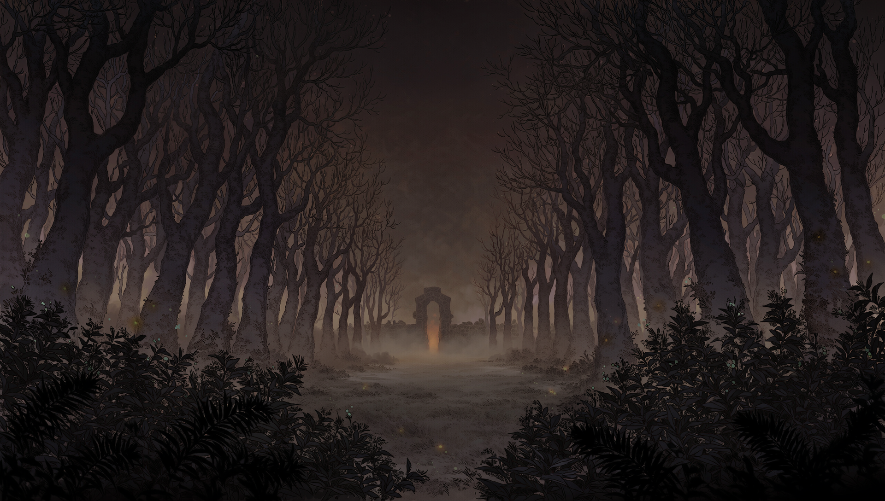
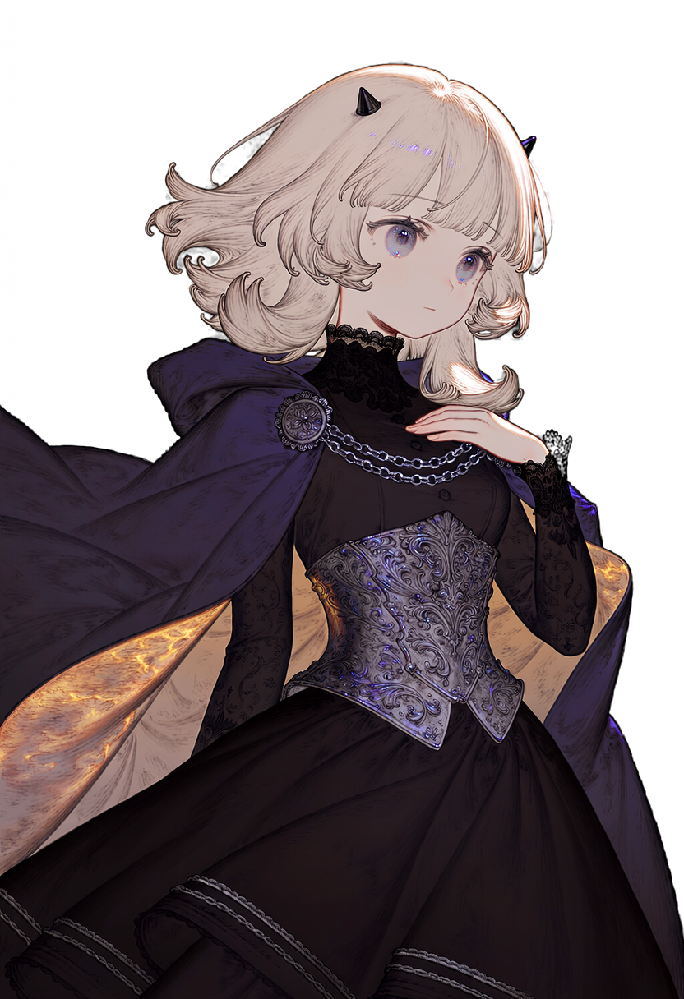
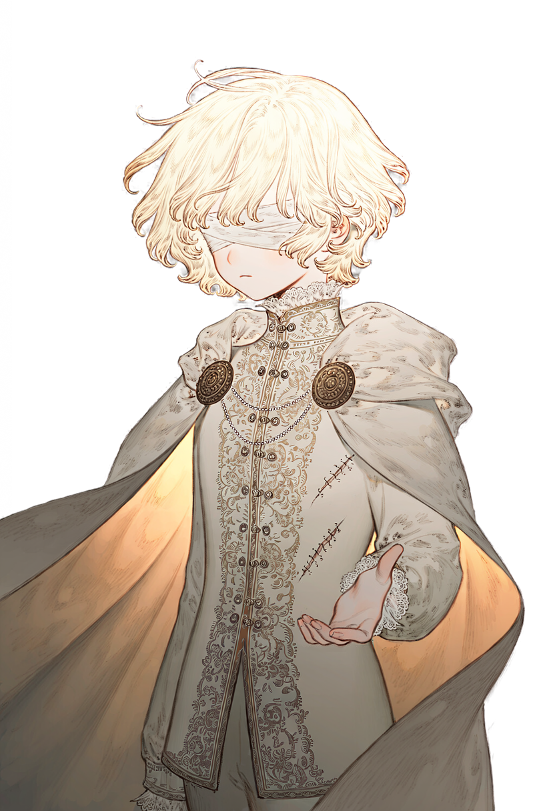

# Dusk Princess and Twilight Prince



**눈이 불편한 왕자와 귀가 들리지 않는 공주가 서로의 감각이 되어 황혼의 숲을 오르는 플랫포머 퍼즐 게임입니다.**

이 게임은 해커톤 주제인 「게임 안에, 모두를 담다」 가운데 **1번 세부 주제, '고정관념과 장벽 깨기: 캐릭터도, 플레이도, 누구나 자유롭게'** 에 맞추어 개발했습니다.

| 항목 | 내용 |
| --- | --- |
| 장르 | 2D 플랫포머 퍼즐 |
| 플레이 인원 | 1인 (두 주인공을 번갈아 조작) |
| 플레이 시간 | 약 15분 |
| 개발 환경 | Unity 6000.3, URP 2D Renderer |

## 게임 소개

전쟁으로 귀를 잃고 추방당한 공주와 암습으로 눈을 잃은 왕자가 저주받은 숲에서 만납니다. 두 사람은 눈과 귀를 고쳐 준다는 샘물의 소문을 따라 숲의 가장 어두운 곳으로 함께 향합니다.

플레이어는 두 사람을 언제든지 전환하며 조작합니다. 조작하는 인물을 바꾸면 그 인물이 세계를 느끼는 방식에 맞추어 화면과 소리도 함께 달라집니다.

<table>
  <tr>
    <th width="50%">공주</th>
    <th width="50%">왕자</th>
  </tr>
  <tr>
    <td></td>
    <td></td>
  </tr>
  <tr>
    <td>
      <b>볼 수 있지만 들을 수 없습니다.</b><br>
      세계가 밝게 보이는 대신 효과음이 사라지고 음악은 먹먹하게 들립니다. 소리 정보는 진동선과 의성어 자막으로 표시됩니다.<br><br>
      무거운 상자를 밀고 당기며, 왕자의 화면에는 보이지 않는 그림을 읽습니다.
    </td>
    <td>
      <b>들을 수 있지만 볼 수 없습니다.</b><br>
      세계가 어둠에 잠겨 있고, 메아리가 닿은 곳만 잠시 드러납니다.<br><br>
      메아리로 숨은 발판과 가짜 벽을 찾아내고, 금빛 물체에 말을 걸어 길이를 바꾸거나 떠 있는 돌을 떨어뜨립니다.
    </td>
  </tr>
</table>

### 스테이지 구성

게임은 프롤로그 그림책으로 시작하여 다섯 단계와 단계 사이의 막간 그림책을 거친 뒤 엔딩 그림책으로 끝납니다.

1. 서로 다른 두 사람
2. 네 말이 빛이 될 때
3. 작은 손이 여는 길
4. 보이지 않는 문을 두드리며
5. 우리가 함께 오르는 황혼

### 조작법

| 동작 | 키보드 | 게임패드 |
| --- | --- | --- |
| 이동 | A / D, ← / → | 왼쪽 스틱, D-pad |
| 점프 | Space, W, ↑ | A |
| 감각 전환 | Tab, Q | Y |
| 메아리 (왕자) | E | X |
| 상호작용, 상자 잡기 | E | B |
| 음성 입력 (왕자) | V를 누른 채 말하기 | LB |
| 체크포인트로 되돌리기 | Backspace | Select |

왕자가 상호작용할 수 있는 대상 근처에 있을 때 E를 짧게 누르면 상호작용을 실행하고, 길게 누르면 메아리를 보냅니다.

## 해커톤 주제: 고정관념과 장벽 깨기

### 역할에 대한 고정관념을 뒤집었습니다

이 게임에서 힘을 쓰는 사람은 왕자가 아니라 공주입니다. 공주는 왕자보다 힘을 더 잘 쓰기 때문에 무거운 상자를 옮기고 압력판을 눌러 철문을 엽니다. 왕자는 섬세한 감각으로 숨은 길을 찾아내고 말로 세계를 바꿉니다. 구해지는 공주와 구하는 왕자라는 익숙한 구도 대신, 두 사람은 각자 잘하는 일로 서로에게 도움을 줍니다.

### 신체적 제약을 함께 넘어서는 과정을 퍼즐로 만들었습니다

두 주인공은 눈이나 귀를 고쳐서 문제를 해결하지 않습니다. 눈이 불편한 왕자와 귀가 들리지 않는 공주가 힘을 합쳐 신체적 제약을 넘어서는 과정이 곧 게임의 핵심 퍼즐입니다.

- 공주에게 벽으로 보이는 곳이 왕자의 메아리로 확인하면 지나갈 수 있는 가짜 벽일 수 있습니다.
- 왕자의 화면에 보이지 않는 그림은 공주만 읽을 수 있으므로, 답을 찾으려면 공주의 시선이 필요합니다.
- 왕자는 말로 다리를 늘일 수 있지만 상자를 밀 수 없고, 공주는 상자를 밀 수 있지만 다리를 늘일 수 없습니다.

따라서 플레이어는 어느 한쪽의 감각만으로 끝까지 진행할 수 없습니다. 두 감각은 우열을 가리는 대상이 아니라 서로를 보완하는 능력으로 표현됩니다. 이야기의 결말도 치료가 아니라, 서로의 감각이 된 두 사람이 함께 나아가는 모습으로 마무리됩니다.

### 더 많은 사람이 즐길 수 있도록 플레이 방식을 넓혔습니다

- 소리로 전달되는 정보는 진동선과 의성어 자막으로도 제공합니다.
- 왕자의 음성 명령에는 정해진 정답 문장이 없습니다. "길어져", "쭉 늘어나라"처럼 플레이어가 자신의 말투로 말해도 게임이 뜻을 판단합니다.
- 떨어져도 가까운 체크포인트에서 바로 다시 시작할 수 있고, 퍼즐이 꼬이면 체크포인트 상태로 되돌릴 수 있습니다.

## AI 활용 내역

### 개발에 사용한 AI

| 도구 | 분류 | 활용 내용 |
| --- | --- | --- |
| Autosprite | 애니메이션 생성 AI | 정적 이미지에서 애니메이션 스프라이트를 생성했습니다. |
| Suno | 음악 생성 AI | 게임에 사용하는 음악을 생성했습니다. |
| NovelAI | 이미지 생성 AI | 게임에 사용하는 이미지를 생성했습니다. |
| Claude Code, Antigravity, Codex | AI 코딩 에이전트 | 게임 개발에 코딩 에이전트로 활용했습니다. |

### AI를 활용한 게임 내 새로운 플레이 지원 기능

| 기술 | 역할 | 게임 내 활용 내용 |
| --- | --- | --- |
| Whisper | STT 엔진 | 플레이어가 왕자의 목소리로 말한 내용을 글자로 변환합니다. |
| Kanana | 결정 엔진 | 변환된 말의 뜻을 판단하여 금빛 물체와 떠 있는 돌에 적용할 결과를 결정합니다. |

음성 입력은 다음 순서로 처리됩니다.

1. 플레이어가 V를 누른 채 금빛 물체에 말을 겁니다.
2. Whisper가 음성을 글자로 변환합니다. 이때 현재 장면에서 쓰이는 명령어를 힌트로 제공하고, 자모 하나 정도 다르게 인식된 말은 게임 코드에서 보정합니다.
3. 게임은 자주 쓰이는 표현을 먼저 즉시 판정하고, 판단하기 어려운 표현만 Kanana에 전달합니다.
4. Kanana는 자유로운 문장을 생성하지 않고, 미리 정해진 선택지 중에서 말의 뜻에 맞는 결과를 고릅니다.
5. 게임이 그 결과에 따라 다리와 기둥의 길이를 바꾸거나 떠 있는 돌을 떨어뜨립니다.

Whisper와 Kanana는 모두 플레이어의 PC에서 로컬로 실행합니다. 그래서 두 기능을 사용할 때 API 키나 네트워크 연결이 필요하지 않고, 플레이어의 음성도 외부로 전송하지 않습니다.

## 실행 방법

이 저장소에는 용량이 큰 AI 모델 파일이 포함되어 있지 않으므로, 프로젝트를 클론한 뒤 다음 배치 파일을 한 번 실행해야 합니다.

```bash
Tools/download_assets.bat
```

그다음 Unity 6000.3.27f1에서 프로젝트를 열고 `Assets/Scenes/Title.unity` 씬을 재생합니다. 음성 입력 기능을 사용하려면 마이크가 필요합니다.

## 라이선스 고지

게임에 포함된 타사 에셋과 폰트의 라이선스는 [`Assets/_Project/ThirdPartyLicenses`](Assets/_Project/ThirdPartyLicenses)에서 확인할 수 있습니다.
